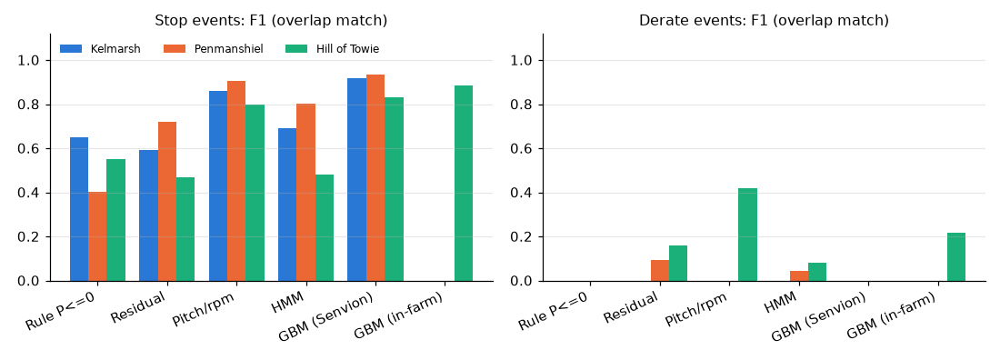
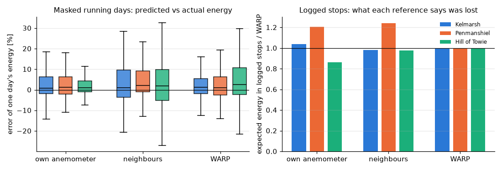
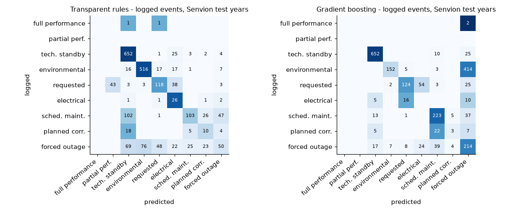
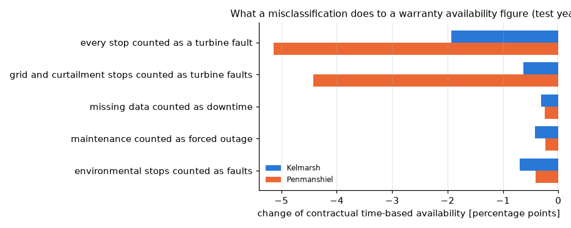

# Wind turbine downtime, its causes and availability from 10-minute SCADA

[](https://github.com/kwwaleszczynski-del/wind-downtime-availability/actions/workflows/ci.yml)

**Interactive dashboard - event timeline per turbine, method comparison, availability calculator:
[kwwaleszczynski-del.github.io/wind-downtime-availability](https://kwwaleszczynski-del.github.io/wind-downtime-availability/)**

Every availability guarantee, O&M invoice and lost-production claim starts from the same three questions: *when*
was a turbine stopped or limited, *why*, and *how much energy did it cost*. The usual answer is the controller's
status log mapped onto the IEC 61400-26 categories. This project asks how far one gets **from the 10-minute
signals alone** - power, wind speed, rotor speed, pitch, nacelle direction, temperature - and what it does to the
contractual numbers when the answer is wrong. It compares six ways to find stops and deratings, two ways to name
their cause, three ways to estimate the energy lost, and turns all of it into time-based (IEC 61400-26-1) and
energy-based (IEC 61400-26-2) availability, on three open wind farms with turbines of two manufacturers:

| Farm | Turbines | Years used | What the operator logged (the yardstick) |
|---|---|---|---|
| Kelmarsh (UK) | 6 x Senvion MM92, 2.05 MW | 2016 (from COD) - 2021 | status log with an IEC category per event; lost production |
| Penmanshiel (UK) | 14 x Senvion MM82, 2.05 MW | 2018, 2020 | the same, including curtailment ("P output externally reduced") |
| Hill of Towie (UK) | 21 x Siemens SWT-2.3-VS-82, 2.3 MW | 2021 | shutdown seconds per interval; controller stop timers (grid, environment, turbine error); power setpoint; alarm log |

It complements the earlier projects of this portfolio, which look for *subtle* faults while the turbine runs:
[power curves and underperformance](https://github.com/kwwaleszczynski-del/wind-power-curve-kelmarsh),
[wake-aware performance verification (WARP)](https://github.com/kwwaleszczynski-del/wind-wake-aware-verification),
[thermal normal-behaviour models](https://github.com/kwwaleszczynski-del/wind-thermal-nbm),
[a Bayesian digital twin](https://github.com/kwwaleszczynski-del/wind-bayes-twin),
[a fruit-fly novelty detector](https://github.com/kwwaleszczynski-del/fly-novelty-scada) and
[causal verification of upgrades](https://github.com/kwwaleszczynski-del/res-uplift-verification). Here the
subject is the turbine that does *not* run normally: stops, deratings, curtailment, their causes and their cost.
The Kelmarsh reader comes from the first project and the WARP reference from the second; both are used as
dependencies, not copied.

The tool runs on any farm's data in a simple long format, with an optional table that maps your controller's
status codes to IEC categories - see [Use it on your own data](#use-it-on-your-own-data).

## Key results

All numbers are measured on test periods that no method saw during development or training: Kelmarsh
2020-2021, Penmanshiel 2020, Hill of Towie July-December 2021 (protocol in [Validation](#validation)).

**1. Finding stops: the pitch and rotor-speed signature is the best label-free method; gradient boosting is
better where it was trained and still good on another manufacturer.**

| Stop events: F1 (recall / precision) | Kelmarsh | Penmanshiel | Hill of Towie (Siemens) |
|---|---|---|---|
| Rule: power <= 0 at >= 3.5 m/s | 0.65 (0.55 / 0.79) | 0.40 (0.76 / 0.28) | 0.55 (0.47 / 0.66) |
| Power curve residual + hysteresis | 0.59 (0.50 / 0.72) | 0.72 (0.67 / 0.79) | 0.47 (0.32 / 0.88) |
| **Pitch / rotor speed signature** | **0.86** (0.87 / 0.85) | **0.91** (0.91 / 0.90) | **0.80** (0.81 / 0.79) |
| HMM segmentation (unsupervised) | 0.69 (0.70 / 0.68) | 0.80 (0.90 / 0.72) | 0.48 (0.32 / 0.99) |
| Gradient boosting, trained on the Senvions | **0.92** (0.95 / 0.89) | **0.93** (0.98 / 0.89) | 0.83 (0.87 / 0.80) |
| Gradient boosting, trained on Hill of Towie Jan-Jun | | | **0.89** (0.95 / 0.83) |

- The everyday rule "no power although the wind is above cut-in" misses every stop during low wind and calls
  low-wind idling a stop: at Penmanshiel, whose turbines start producing only at 3.5-4 m/s, it raises 4,833
  alarms for 1,412 logged stops. A parked rotor - blades feathered to the parking angle, rotor still - is a far more reliable
  sign, at any wind speed, and it needs no training.
- **Transfer Senvion -> Siemens works for stops:** the model trained on two Senvion farms reaches 0.83 on the
  Siemens farm against 0.89 for the same model trained on that farm's own first half-year. All features are
  relative to each turbine's own normal-behaviour curves and rated values; the parking angle (about 92° Senvion,
  77° Siemens) and the low-wind idling (45° blades, rotor nearly still, vs 0° blades, rotor turning) are learned
  from the unlabelled data.
- Event durations agree to the interval: median absolute duration error 0 to 10 minutes for the signature and
  gradient boosting.
- **Deratings are the hard part.** The best result is the pitch signature on Hill of Towie's setpoint
  curtailments: F1 0.42, with 88 % precision but 27 % recall; the curtailments at Penmanshiel (a cap at 88 % of
  rated in strong wind) are found by the power curve residual only (recall 0.33, precision 0.06). A limit that
  binds for a few 10-minute intervals moves the power by a few per cent, the size of ordinary scatter.



**2. Lost energy: the stopped turbine's own anemometer is biased, and the sign depends on the turbine type.**
With the rotor stopped, the nacelle anemometer no longer sits in the slowed-down air behind a working rotor (and
a stopped turbine may not track the wind). Compared with the wind speed its running neighbours imply, it reads
**3.0 % high at Kelmarsh, 2.6 % low at Penmanshiel and 9.2 % low at Hill of Towie** (while running: within
0.5 %). On running days hidden from the method it is the most precise reference, which is exactly why the bias
is easy to miss.

| Logged stops, test periods | own anemometer | running neighbours | WARP | operator (Greenbyte) |
|---|---|---|---|---|
| Kelmarsh: lost energy [MWh] | 1,959 | 1,847 | 1,885 | 1,999 |
| Penmanshiel | 2,060 | 2,117 | 1,707 | 1,997 |
| Hill of Towie | 2,092 | 2,370 | 2,421 | - |
| Error of one masked running day, median (robust SD) | +0.7..+1.2 % (3.3-5.9 %) | +1.1..+2.2 % (6.5-11.3 %) | +1.1..+2.6 % (5.1-8.7 %) | |

On Hill of Towie the own-anemometer method books **14 % less lost energy** than the wake-aware neighbour reference.
At Penmanshiel the references part ways in the high-wind stops (mean 22 m/s): whether the free stream was above
cut-out decides whether anything was lost at all (own anemometer 927 MWh, WARP 644 MWh); outside them the three
agree within 9 %.

The Kelmarsh row covers only the logged stops of the test years 2020-2021. Over 2016-2021 the same farm's losses
are 3.1 GWh in [wind-power-curve-kelmarsh](https://github.com/kwwaleszczynski-del/wind-power-curve-kelmarsh) (all
non-normal SCADA states) and 3.43 GWh in
[wind-om-reliability](https://github.com/kwwaleszczynski-del/wind-om-reliability) (all stop intervals of the
status log). Each is compared with Greenbyte on its own scope, and none prices the SCADA gaps behind 2.3 GWh of
Greenbyte's 5.6 GWh for 2016-2021.



**3. Lost energy from the detected events** (same WARP expected power on both sides, so the difference is the
detector's alone) is within **-1 % to +4 % of the logged states for gradient boosting** and -10 % to -1 % for the
pitch signature, which misses some partially stopped intervals. The HMM over-counts at Penmanshiel (+15 %).

**4. Why it stopped: signals alone get the big categories right, not the contractual subtleties.** On the logged
events of the Senvion test years the transparent rules name the right category for 58 % (Kelmarsh) and 74 %
(Penmanshiel) of events, gradient boosting for 78 % and 58 %. Each is good where the other fails: the rules
recognise high-wind stops (516 of 549 at Penmanshiel; gradient boosting calls 410 of them forced outages), the
model separates maintenance from faults better (223 of 279 maintenance events vs 103). Grid trips, park
controller stops and technical standby are recognised well by both; **scheduled maintenance vs planned corrective
action vs forced outage cannot be separated reliably from 10-minute signals** - they look the same on SCADA, and
that is exactly the distinction a warranty depends on. On Hill of Towie, whose operator books short low-wind
stops as *environmental* where the Senvion operators book them as *technical standby*, both classifiers transfer
poorly (19-30 % of events).



**5. What it does to contractual availability.** Per turbine-year, the time-based warranty availability from
the signals (signature detector + rules) is within **0.5-1.0 percentage points** of the one from the logs (mean
absolute error; gradient boosting 0.3-1.0 pp). Booking the wrong cause moves it by more:

| Warranty time-based availability (typical OEM preset), change vs logs | Kelmarsh | Penmanshiel |
|---|---|---|
| every stop counted as a turbine fault | **-1.9 pp** | **-5.1 pp** |
| grid trips and curtailment / park controller stops counted as turbine faults | -0.6 pp | **-4.4 pp** |
| high-wind, icing and low-temperature stops counted as faults | -0.7 pp | -0.4 pp |
| scheduled maintenance counted as forced outage (60 h allowance lost) | -0.4 pp | -0.2 pp |
| missing data counted as downtime | -0.3 pp | -0.3 pp |

At Penmanshiel in 2020 the logged warranty availability is 97.9 %. Count the grid operator's and the park
controller's stops as turbine faults and it falls to 93.5 % - below a typical 97 % guarantee, which with the
common formula *shortfall x potential energy x price* is **about EUR 0.23 million of liquidated damages for one
farm-year** (81.5 GWh potential, 80 EUR/MWh) that are not owed. The calculator in the dashboard does this for any
category treatment, allowance, guarantee and price.



**6. A trap in the data.** Penmanshiel's 15-day farm-wide park controller stop (25 September - 10 October 2020,
5,150 turbine-hours) left rows without power or wind readings in SCADA. A signal-only tool sees a data gap, not a
stop; the operator's system booked 3.8 GWh of lost production to it, which no method here can estimate without an
external wind source. Whether a contract treats such gaps as available, unavailable or excluded is worth reading
before trusting any availability figure computed from SCADA.

## The categories

IEC 61400-26-1 sorts every moment of a turbine's life into information categories. The ten used here (the
standard's tree is finer, and its exact definitions and their contractual use should be checked against the
current edition and the contract itself):

| Key | Category | State in the signals |
|---|---|---|
| `full_performance` | operative, generating at full performance (also idling for lack of wind) | normal |
| `partial_performance` | generating, derated for a technical reason | derate |
| `technical_standby` | non-generating, operative: cable unwinding, self-tests, start-up | stop |
| `environmental` | out of environmental specification: high wind, icing, temperature, low wind | stop |
| `requested` | requested shutdown or curtailment by the grid operator or the owner | stop or derate |
| `electrical` | out of electrical specification: grid loss, voltage or frequency out of range | stop |
| `scheduled_maintenance` | non-operative, planned maintenance | stop |
| `planned_corrective` | non-operative, planned repair of a known defect | stop |
| `forced_outage` | non-operative, unplanned: a fault | stop |
| `no_info` | information unavailable: data gap, lost communication, frozen signals | no data |

**How the open logs map onto them.** Kelmarsh and Penmanshiel come with the operator's own (Greenbyte) IEC
category per status event, used as is. Two additions are assumptions, stated as such:

- *Planned corrective action* is not a Greenbyte category. An on-site manual stop (Greenbyte: scheduled
  maintenance) that starts more than one hour and at most three days after a forced outage of the same turbine
  ended is taken as the planned follow-up repair; one that starts within the hour continues the forced outage.
- Code 9000 *P output externally reduced* is an external instruction (`requested`); other power reductions
  (gearbox, converter) are `partial_performance`. A logged reduction counts as a derate only where it binds:
  the turbine produced at least 5 % of rated less than its normal curve at that wind speed.

Hill of Towie publishes no IEC categories. A stop is an interval with >= 300 s of shutdown in the operator's
published shutdown durations; its cause comes from the controller's stop timers (grid stop -> `electrical`,
environmental stop -> `environmental`, turbine error -> `forced_outage`, each >= 300 s), else from the 12 alarm
codes the dataset describes (icing, high and low wind -> `environmental`; cable untwisting, pitch lubrication ->
`technical_standby`); the rest stays unknown. A derate is a power setpoint below 97 % of rated at which the
turbine actually runs while its normal curve says the wind would give at least 5 % of rated more.

## Methods

### Finding stops and deratings without status codes

Every method sees only the generic signals and labels each 10-minute interval *normal*, *derate*, *stop* or *no
data*. Missing and frozen data are decided first and the same way for all: a row that is absent, has no power or
wind speed, or whose power, wind speed and rotor speed repeat exactly for 30 minutes (a stuck data link).

Each turbine's **normal-behaviour curves** - power, pitch and rotor speed against its nacelle wind speed - are
binned medians learned from the data itself, in two passes (the second drops intervals more than 15 % of rated
below the first-pass power curve), so that no labels are needed. The parking angle is the 99th percentile of
the pitch while not producing.

| Method | Stop | Derate |
|---|---|---|
| rule | power <= 0 at >= 3.5 m/s | - |
| power curve residual | power <= 2 % of rated where >= 5 % is expected | power short by > 5 % of rated *and* held flat (three intervals within 1.5 % of rated: a setpoint), or short by > 25 %, for 20 minutes; ends after 20 minutes with less than 3 % short (hysteresis) |
| pitch / rotor speed signature | rotor below 15 % of rated speed with the blades within 15° of the parking angle, at any wind speed; without a pitch signal, a still rotor where power is expected | pitch > 3° beyond normal at that wind speed, rotor at speed, power short by > 5 % of rated (same hysteresis) |
| HMM | hidden states *normal*, *idle*, *derate*, *stop* with Gaussian emissions of three features (below), learned by Baum-Welch on the farm's own unlabelled data, decoded by Viterbi | |
| gradient boosting | `HistGradientBoostingClassifier` on 28 relative features per interval, trained on the logged states | |

The HMM's features are relative to the normal curves $`\hat P(u)`$, $`\widehat{\beta}(u)`$ (pitch) and $`\hat n(u)`$
(rotor speed):

```math
f_1 = \frac{P - \hat P(u)}{P_r}, \qquad
f_2 = \frac{\beta - \widehat{\beta}(u)}{\beta_{\mathrm{park}} - \widehat{\beta}(u)}, \qquad
f_3 = \frac{n - \hat n(u)}{n_r}
```

so that 0 is normal operation and $`f_2 = 1`$ a parked rotor on any turbine. The states start from physical values
(the *idle* state from where this farm's turbines actually idle) and their means are shrunk towards them during
Baum-Welch, the derate state almost completely: otherwise it drifts to absorb start-ups and gusts. Leaving a
state costs probability, so a single noisy interval cannot split a stop.

The gradient boosting features are the interval's power and expected power over rated, shortfall, wind speed
above cut-in, pitch beyond normal and relative to the parking angle, rotor speed relative to rated and to normal,
temperature; the same 10 and 30 minutes before and after; the spread of power over an hour; and the farm context
(share of the other turbines standing still where power is expected, their median shortfall).

### Naming the cause

1. **Status codes + your mapping**, when the logs exist: the dominant code of the event looked up in a
   `code -> category` table. Events without a mapped code fall through to 2.
2. **Transparent rules** on event features (thresholds read off the logged events of the training periods):

   | Condition, checked from top to bottom | Category |
   |---|---|
   | derate, at least half of the farm limited at the same time | `requested` (curtailment) |
   | derate, otherwise | `partial_performance` |
   | stop, 90th percentile of the farm's wind speed >= 18 m/s | `environmental` (high wind) |
   | stop at <= 2 °C, power already short by >= 5 % of rated in the 2 hours before | `environmental` (icing) |
   | stop of at least half of the farm within 20 minutes, at most 20 minutes long | `electrical` (grid trip) |
   | the same, longer | `requested` |
   | stop of at most 30 minutes | `technical_standby` |
   | stop starting Monday-Friday 07-17 local time, at least 1 hour | `planned_corrective` after a stop of >= 1 h that ended in the 3 days before, else `scheduled_maintenance` |
   | any other stop | `forced_outage` |

3. **Gradient boosting** on the same 25 event features (duration, local start time, wind, temperature, the power
   shortfall before the stop, farm synchronicity, parked share, power level and flatness, the previous stop's gap
   and duration, season), trained on the Senvion training events.

The event table reports a confidence with every category: 1 for a status code, else the share of that rule's
verdicts that were right on the training events (`RULE_PRECISION`).

### Expected power and lost energy

Lost energy of an interval in a stop or derate is $`\max(\hat P - P,\ 0) \cdot 10\ \mathrm{min}`$, with three ways
to get $`\hat P`$:

- **own anemometer**: the turbine's normal power curve at its own nacelle wind speed;
- **running neighbours**: the same curve at the median wind speed of the running neighbours, times a transfer
  ratio per 30° sector of their nacelle direction learned in a baseline period (no layout needed);
- **WARP** from [wind-wake-aware-verification](https://github.com/kwwaleszczynski-del/wind-wake-aware-verification):
  the free stream from the turbines that are not waked in the current direction, carried to the turbine through
  a PyWake wake model and a fitted site factor. Here with the wake parameters calibrated at Kelmarsh
  ($`k = 0.035`$, $`\sigma_\theta = 3^\circ`$) on all three farms.

Where no neighbour runs (farm-wide stops), the neighbour references fall back to the own anemometer.

### Availability

A contract assigns every category to *available*, *unavailable* or *excluded* (removed from both sides):

```math
A_t = \frac{T_{\mathrm{avail}}}{T_{\mathrm{avail}} + T_{\mathrm{unavail}}}, \qquad
A_E = 1 - \frac{E_{\mathrm{lost,\,unavail}}}{E_{\mathrm{actual}} + E_{\mathrm{lost}}}
```

with excluded periods left out of every term of $`A_E`$ as well. Two illustrative presets:

| Category | IEC 61400-26-1 operational | Typical OEM warranty |
|---|---|---|
| full and partial performance, technical standby | available | available |
| environmental, requested, electrical | available | **excluded** (excused) |
| scheduled maintenance | unavailable | unavailable beyond an allowance (60 h per turbine-year) |
| planned corrective action, forced outage | unavailable | unavailable |
| information unavailable | excluded | available |

The category totals, both presets and the two availabilities are computed by
[res-asset-kpi](https://github.com/kwwaleszczynski-del/res-asset-kpi) (`res_asset_kpi.wind`), the KPI library
extracted from this and five related projects.

## Validation

| Farm | Labelled training | Test | Baseline for neighbour ratios and WARP |
|---|---|---|---|
| Kelmarsh | 15 Apr 2016 - 2019 | 2020-2021 (12 turbine-years) | 2017 |
| Penmanshiel | 2018 | 2020 (14 turbine-years) | 2018 |
| Hill of Towie | none for the main model (transfer); Jan-Jun 2021 for the in-farm comparison | Jul-Dec 2021 (21 turbine half-years) | Jan-Jun 2021 |

- The supervised detector and the event classifier are trained on the Senvion training periods only. The
  label-free parts (normal curves, HMM) are learned on each farm's own unlabelled data, as they would be in use.
  The rule thresholds were read off the training events.
- **Events** match when a detected and a logged event of the same state share at least one interval; recall is
  the share of logged events matched, precision the share of detected events matched. Duration error compares
  each logged event with the detected event that overlaps it most.
- **Lost energy** of a detector is compared with the lost energy of the logged states under the same expected
  power (WARP), so the difference is the detector's. The references themselves are checked by hiding a running
  turbine's power for a day (400 random turbine-days per farm, kept if >= 95 % normal operation and >= 2 MWh) and
  on the logged stops against each other and the operator's lost-production figures.
- **Availability** per turbine-year from the detected states and classified causes, against the same figure from
  the logged categories; on Hill of Towie, where causes are only partly logged, every stop counts as unavailable
  on both sides.

## Limitations

- **The logs are not the truth.** They are the operator's booking: stops shorter than half an interval vanish,
  categories follow each operator's conventions (low-wind stops are technical standby at the Senvion farms and
  environmental at Hill of Towie), and the planned corrective category is derived by an assumption.
- **Few deratings.** The test periods hold 89 (Penmanshiel) and 179 (Hill of Towie) logged derate events and none
  at Kelmarsh; derate numbers are less certain than stop numbers.
- **Three UK farms, two manufacturers, one decade of controllers.** Pitch conventions, idling behaviour and
  logging differ elsewhere; the curves and the HMM adapt from data, the rule thresholds and the trained models may
  not.
- **Signals cannot tell some categories apart.** Scheduled maintenance, planned corrective action and forced
  outage look the same in 10-minute SCADA; status codes are needed for them.
- **Expected power during high-wind stops** depends on the cut-out behaviour, which none of the references
  models explicitly; in SCADA gaps nothing is estimated.
- **The contract presets are illustrative.** IEC 61400-26 leaves the allocation to the contract; check the real
  definitions before using any number.

## Use it on your own data

Export the 10-minute SCADA of a farm as one long table (Parquet or CSV), one row per turbine and interval:

| Column | Meaning | Required |
|---|---|---|
| `timestamp` | start of the 10-minute interval, UTC | yes |
| `turbine_id` | any string | yes |
| `power` | mean active power [kW] | yes |
| `wind_speed` | mean nacelle wind speed [m/s] | yes |
| `rotor_speed` | mean rotor speed [rpm] (generator speed / gear ratio also works) | yes |
| `pitch` | mean blade pitch angle [°] | yes |
| `nacelle_dir` | nacelle position / yaw angle [°] | yes |
| `ambient_temp` | ambient (or nacelle outside) temperature [°C] | yes |
| `status_code` | the status code active in the interval, any string | no |

Missing values are allowed. Optional inputs:

- `--mapping codes.csv` with columns `code,category`, the categories being the keys of the table in
  [The categories](#the-categories) - your own mapping of your controller's codes;
- `--turbines turbines.csv` with `turbine_id,rated_kw` and, for the WARP reference, `lat,lon` (or `x_m,y_m`),
  `hub_height_m,rotor_diameter_m`.

```bash
python -m wind_downtime run scada.parquet --rated-kw 3600 --mapping codes.csv --out out
python -m wind_downtime run scada.parquet --turbines turbines.csv --expected warp --contract iec_operational --out out
```

Options: `--detector signature|residual|hmm|rules` (default `signature`), `--expected neighbours|nacelle|warp`
(default `neighbours`), `--contract oem_warranty|iec_operational`, `--maintenance-allowance-h`, `--tz` (local time
zone for the working-hours rules, default Europe/Warsaw). The outputs in `out/`:

- `events.csv`: turbine, start, end (UTC), duration, state, category, `category_source` (status code / signal
  rules / missing data), confidence, lost and expected energy [kWh], mean wind speed, dominant status code;
- `kpi_turbine_year.csv` and `kpi_farm_year.csv`: time- and energy-based availability under the chosen contract,
  hours and lost MWh per category;
- `intervals.parquet`: state, category and lost energy of every interval.

A Penmanshiel year with its operator's code mapping makes a ready-made example input:
`python -m wind_downtime export penmanshiel --years 2020 --out demo` (14 turbines, one year: about 30 s).

## Run it

```bash
pip install -e ".[dev]"
pytest -q                                                          # 22 tests on a synthetic farm, offline
export KELMARSH_DATA_DIR=../wind-power-curve-kelmarsh/data          # or fetch Kelmarsh with that project
python -m wind_downtime fetch --penmanshiel 2018 2020 --hill-of-towie 2021   # ~2.7 GB from Zenodo, once
python -m wind_downtime study                                      # ~7 minutes: results/ and docs/
```

`fetch` downloads the Penmanshiel archives whole (MD5 checked) and reads only the five needed tables out of the
Hill of Towie yearly archive through HTTP range requests (CRC checked), about three quarters of its size.

```
src/wind_downtime/
  schema.py        the long format, IEC categories, the time x turbine array view
  fetch.py         Zenodo downloads, remote zip members by range requests
  sources.py       Kelmarsh (via wind_power_curve), Penmanshiel, Hill of Towie -> long format + references
  reference.py     interval states and categories from the operators' logs
  curves.py        normal-behaviour curves: power, pitch, rotor speed vs wind speed
  detect.py        missing / frozen data, rule, residual with hysteresis, pitch and rotor speed signature
  hmm.py           four-state Gaussian HMM, Baum-Welch and Viterbi
  ml.py            interval features and the gradient boosting detector
  events.py        intervals -> events, overlap matching, scores
  classify.py      event features, rules, gradient boosting, status code mapping
  energy.py        expected power: own anemometer, neighbours, WARP; lost energy
  availability.py  category codes -> res-asset-kpi availability, misclassification scenarios
  pipeline.py      the `run` command for your own data
  study.py         the comparison on the three open farms
  report.py, dashboard.py, cli.py
tests/             a synthetic farm with known stops, deratings and gaps (no network)
```

## Data and license

Code: MIT. Data, all CC BY 4.0, downloaded on demand and not part of this repository (`results/` and the
dashboard hold derived figures only):

- *Kelmarsh wind farm data*, C. Plumley, Cubico Sustainable Investments,
  [doi:10.5281/zenodo.16807551](https://doi.org/10.5281/zenodo.16807551).
- *Penmanshiel wind farm data*, C. Plumley, Cubico Sustainable Investments,
  [doi:10.5281/zenodo.16807304](https://doi.org/10.5281/zenodo.16807304).
- *Hill of Towie wind farm open dataset*, version 2.1.0, RES on behalf of TRIG,
  [doi:10.5281/zenodo.22662930](https://doi.org/10.5281/zenodo.22662930) (concept DOI
  [10.5281/zenodo.14870021](https://doi.org/10.5281/zenodo.14870021)); companion code
  [resgroup/hill-of-towie-open-source-analysis](https://github.com/resgroup/hill-of-towie-open-source-analysis).

Wake model: [PyWake](https://gitlab.windenergy.dtu.dk/TOPFARM/PyWake) (DTU Wind Energy, MIT).
